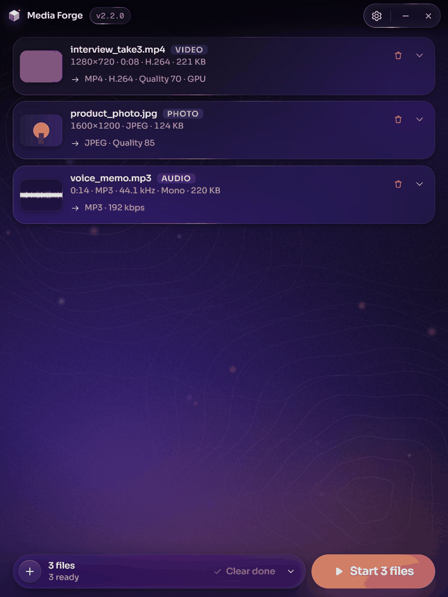
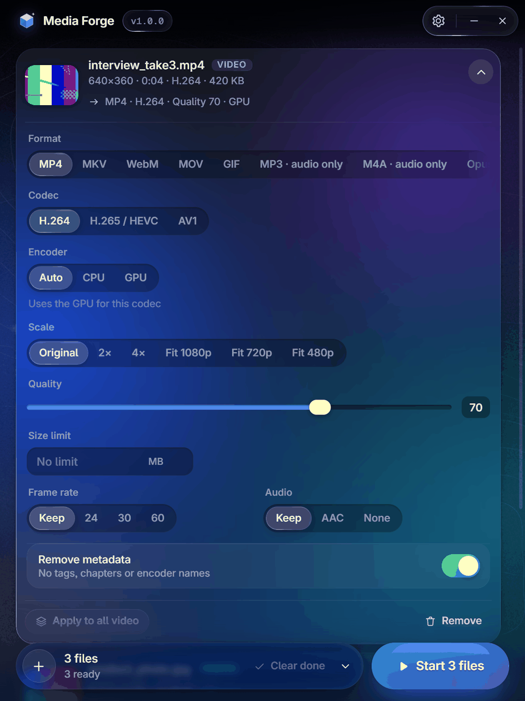

<div align="center">



[](https://github.com/softoblivion/media-forge/releases/latest/download/MediaForge.exe)
[](https://github.com/softoblivion/media-forge/releases/latest)


[](LICENSE)

**Compress, upscale and convert video, photos and audio on Windows: drop files, give each its own settings, press Start. Compress to a quality or to a size limit in MB, upscale 2x / 4x without inventing pixels, convert between the common video, image and audio formats. Outputs carry no metadata. One portable exe, no installer, no account; updates itself from GitHub Releases.**




<sub>Drop files on the window · open a file's settings · press Start. Outputs land next to the sources.</sub>

</div>

---

## Why Media Forge

- **Three jobs, one window.** Compress, upscale and convert are the same panel: pick the output format, the
  codec, the quality or a size limit, the scale. Every file in the list keeps its own settings; one click copies
  them to the other files of the same kind.
- **A size limit that holds.** Type a number of MB and the output stays under it: two-pass bitrate targeting for
  video, a quality search and then a downscale ladder for photos, a bitrate from the duration for audio.
- **Upscale without invention.** 2x / 4x by Lanczos resampling with a light sharpen, or by a small deterministic
  super-resolution network (FSRCNN bundled, EDSR for photos, downloaded once). The same input always gives the
  same output; nothing is painted in from noise or text.
- **Clean outputs.** By default no EXIF, XMP, IPTC, chapters, encoder tags or provenance manifests of any kind.
  Only the ICC colour profile is kept.
- **Free and open source.** GPL-3.0, no trial, no watermark, no paid tier. The source is here; build it yourself
  if you prefer.
- **Portable.** One `MediaForge.exe` with a data folder next to it, no installer. Move the folder, move the app.
  The second launch brings the running window to the front.

## Quick start

1. Download [`MediaForge.exe`](https://github.com/softoblivion/media-forge/releases/latest/download/MediaForge.exe)
   into a folder of its own, for example `D:\Apps\MediaForge\`.
2. Run it. FFmpeg is taken from `PATH` or downloaded once into the data folder; an NVIDIA GPU is used for encoding
   when the machine has one.
3. Drop files or folders on the window (or press `Ctrl+O`), open a file's settings if the defaults are not what
   you want, press **Start**. Outputs are written next to the sources as `<name>_forge.<ext>`.

**Requirements:** Windows 10 or 11 with the Microsoft Edge WebView2 Runtime (preinstalled on Windows 11 and on
up-to-date Windows 10). No installer, no admin rights.

> [!NOTE]
> The executable is not code-signed, so Windows SmartScreen may warn on first start (**More info → Run anyway**).

## Features

| | |
|---|---|
| **Compress video** | H.264, H.265 / HEVC, AV1 (CPU, or NVIDIA NVENC when present), VP9 and ProRes. A quality slider (100 = visually lossless) or a size limit in MB. Fit to 1080p / 720p / 480p, frame rate 24 / 30 / 60, audio kept, re-encoded to AAC or dropped. |
| **Compress photos and audio** | JPEG, WebP, AVIF, HEIC by quality or by size limit; MP3, AAC, Opus, OGG at a chosen bitrate or a size limit, with optional EBU R128 loudness normalisation. |
| **Upscale 2x / 4x** | Lanczos with a light sharpen (fast), FSRCNN (bundled, moderate) or EDSR (photos only, downloaded once, 38 MB per scale, best detail). Video frames stream through FFmpeg pipes; the thumbnail and the ETA show what to expect. |
| **Convert** | Video to MP4, MKV, WebM, MOV, GIF, or its audio track to MP3, M4A, Opus, FLAC, WAV; photos between JPEG, PNG, WebP, AVIF, TIFF, BMP, HEIC; audio between MP3, M4A, Opus, OGG, FLAC, WAV. |
| **Clean outputs** | **Remove metadata** is on per file by default: no tags, chapters or encoder names in the output. Off copies the source metadata as far as the target format allows. |
| **Per-file settings** | Every file opens its own panel; **Apply to all video / photos / audio** copies one file's settings to the others; the defaults for new files live in Settings. |
| **Batch input** | Drag and drop of files and folders (one level deep), several at once; a native multi-select dialog; duplicates are added once. Up to three files run in parallel. |
| **Outputs** | Next to the source or into one folder; a numbered suffix instead of an overwrite; **Show in folder**, **Open**, **Run again**; an optional folder opening and a sound when a batch finishes. |
| **Liquid Glass UI** | A 3:4 portrait window with refracting glass controls, spring motion and an animated background in one of four colour themes (Dusk, Nova, Frost, Bloom); embedded Unbounded and Geist Mono fonts; animation stops when nothing moves. |
| **Self-updating app** | New releases are detected on launch and then every 5 minutes, downloaded in the background (or on **Download**), verified by size and SHA-256 and installed on **Restart**. |

## Documentation

| Document | What it covers |
|---|---|
| [User guide](docs/USER_GUIDE.md) | Usage, keyboard, settings, formats and codecs, size limit, data folder, updates |
| [Architecture](docs/ARCHITECTURE.md) | Stack, repository layout, modules, runtime data, behaviour, window |
| [Bridge API](docs/BRIDGE_API.md) | The JS ↔ Python contract: methods, events, payload types, option tables |
| [Core](docs/CORE.md) | Probing, FFmpeg command lines, quality mapping, size targeting, upscale, jobs |
| [UI design](docs/UI_DESIGN.md) | Liquid Glass material, background, motion, components, copy rules |
| [Build](docs/BUILD.md) | Running from source, tests, building the exe, releasing, troubleshooting |
| [Release notes](docs/releases/) | What changed in every version |
| [Third-party components](docs/THIRD_PARTY.md) | What is bundled or downloaded, with licences |

## Building from source

Requirements: Windows, Python 3.14 (via the `py` launcher), PowerShell 5.1+, FFmpeg on `PATH` for the tests.

```powershell
git clone https://github.com/softoblivion/media-forge.git
cd media-forge
powershell -ExecutionPolicy Bypass -File build\build.ps1
```

The script creates `.venv`, installs the dependencies, runs the unit tests, draws the icon and produces
`release\MediaForge.exe` (one-file PyInstaller build, about 77 MB, most of it OpenCV) with `release\SHA256SUMS`.

| Task | Command |
|---|---|
| Run from source | `set MEDIA_FORGE_HOME=%TEMP%\mf_scratch` then `scripts\run_dev.bat` (`--fake` runs a simulated engine without touching files) |
| Unit tests | `set MEDIA_FORGE_HOME=%TEMP%\mf_tests` and `set PYTHONPATH=src`, then `.venv\Scripts\python.exe -m unittest discover -s tests -t .` |
| UI in a browser with mock data | `python -m http.server 5173 --directory src\media_forge\ui`, then `http://localhost:5173/?mock=1` |

A single job runs without the window through
`.venv\Scripts\python.exe -m media_forge.core.cli <file> [--set key=value ...]`.

## License

Released under the [GNU General Public License v3.0](LICENSE). Any distributed copy or derivative work must stay
open source under the same license and keep the copyright notices.
